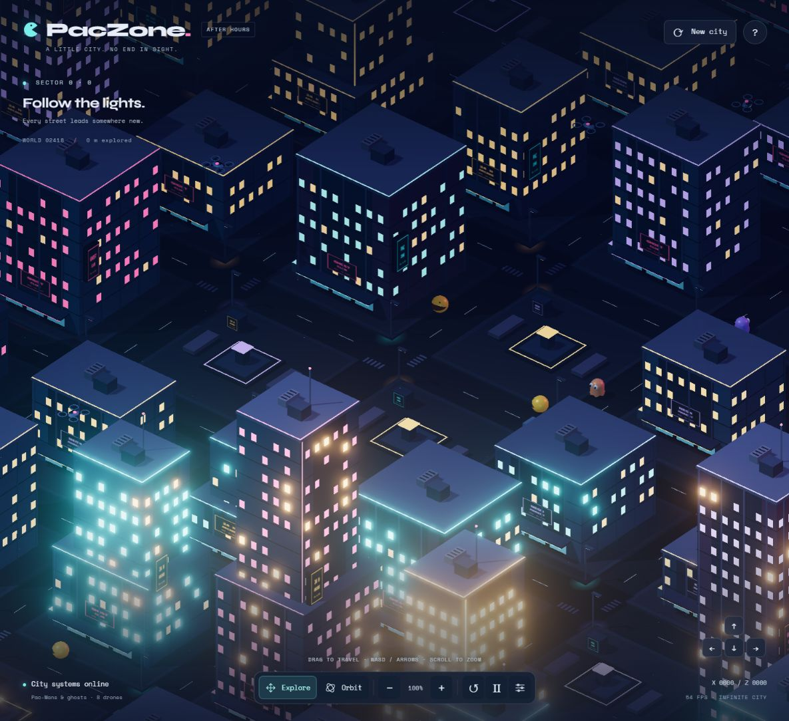

# PacZone — After Hours

An endless, interactive cyberpunk city inhabited by little Pac-Mans, ghosts, delivery drones, and autonomous cars.



## Run locally

Requires Python 3 and a WebGL-capable browser. No build step or package installation is needed.

From the project directory:

```sh
python -m http.server 8765 --bind 127.0.0.1 --directory dist
```

Open **http://127.0.0.1:8765/**. Serve over HTTP rather than opening the HTML file directly. An internet connection is needed for the pinned Three.js modules and Google Fonts.

## Explore

- Drag in **Explore** mode to travel across the ground plane.
- **WASD / arrow keys** travel relative to the view; hold **Shift** to move faster.
- **Scroll / pinch / + / −** zoom in or out.
- **Orbit** or right-drag looks around the current location.
- **Return home** restores the starting position and camera.
- Pause city life or generate a new city from the toolbar.
- Adjust city density, neon glow, and drone traffic in the settings panel.

## How it works

Neighborhoods keep fixed world coordinates. A seeded generator streams 36-meter chunks around the camera, maintaining 25 active chunks and disposing of distant ones. Returning to a coordinate recreates the same buildings for the selected seed.

Buildings, street furniture, and windows use instanced rendering. The scene combines soft shadows, bloom, atmospheric fog, procedural signage, and animated residents that follow street routes.

## Project structure

| File | Purpose |
| --- | --- |
| `dist/city.js` | Camera, exploration controls, lighting, bloom, UI, and render loop |
| `dist/city-world.js` | Deterministic city chunks, buildings, roads, shops, and plazas |
| `dist/city-life.js` | Pac-Man and ghost residents, cars, drones, and their routes |
| `dist/index.html` | Application shell and controls |
| `dist/style.css` | Responsive interface styling |

## Static hosting

Serve the contents of `dist/` with any static web server. The app has no backend or runtime secrets.
